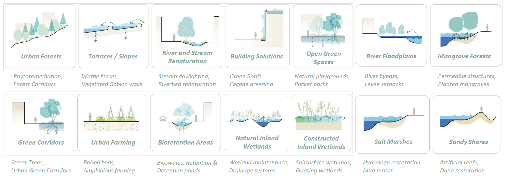
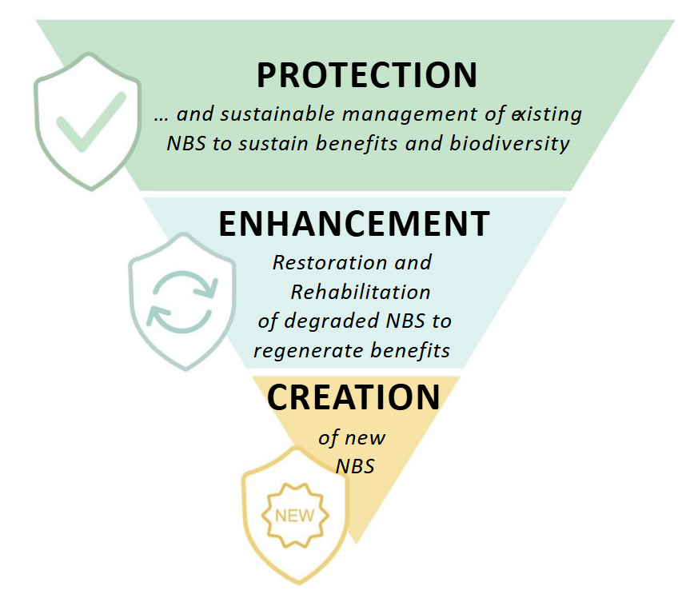

Background
==========

Introduction to the NBSOS
-------------------------

In a wider sense, the NBSOS is not only a tool for nature-based solutions (NbS) assessment, but a participatory process to engage local actors for the elicitation of locally relevant cross-cutting
issues and environmental challenges such as exposure to hazards to gauge local demand for NbS, for the identification of
knowledge needs, and therefore, for defining the scope of a NbS opportunity scan. The NBSOS tool itself is then used to conduct this assessment. In this closer sense, the NBSOS presents a simple geospatial
modelling approach to indicate where NbS can contribute to reduce impact of hazards and build resilience. Thereby, the NBSOS seeks to
inform engagements upstream, or early in the project preparation.

Here, NbS are understood as an umbrella term referring to "actions to protect, sustainably manage, and restore natural or modified ecosystems that address societal challenges effectively and adaptively, simultaneously providing human well-being and biodiversity benefits."
Based on this notion, the NBSOS defines NbS families for assessment, i.e., a diverse range of solutions for urban applications by scale, context and principles, including, e.g., urban forests, open green spaces, green corridors, bioretention areas, river and stream renaturation, etc.
More information on the NbS families considered in the NBSOS can be found in the `Catalogue of Nature-based Solutions for Urban Resilience (World Bank, 2021) <https://documents1.worldbank.org/curated/en/502101636360985715/pdf/A-Catalogue-of-Nature-based-Solutions-for-Urban-Resilience.pdf?>`_.

   Families of nature-based solutions (World Bank, 2021).

Moreover, although complementary to each other, the aforementioned approaches of protection, enhancement or creation of urban nature elements can be considered as a hierarchy,
hence prioritizing the protection of existing ecosystems over enhanced management, rehabilitation and restoration, or the creation of new NBS, as illustrated below.
The NBSOS considers this hierarchy in its approach, first, by quantifying the value of existing green space
within the area of interest (assessment of so-called protection benefits)​, and second, by
estimating the potential benefits that could be achieved through the creation of new NBS (so-called creation benefits).
The perspective of protection benefits povides useful data to inform urban planning by identifying natural
areas that currently provide high benefits and should therefore be protected or enhanced to ensure a
sustained provision of benefits in the future. Creation benefits primarily link to the identification of
investment areas where urban/climate resilience can be bolstered by adding greenery to relatively degraded
land parcels.

    Hierarchy of nature-based solutions approaches (World Bank, 2021).

NBSOS Principles and Methodology
--------------------------------

The NBSOS approach seeks to leverage observational capacities of high-resolution satellite data archives to derive information about
land cover, vegetation, and other environmental characteristics as proxy for the status-quo of urban nature and thus NbS. Consequently, the NBSOS relies on globally available geospatial data with high resolution (typically 10m to 30m), to ensure
easy transferability of the approach to other cities and regions. This also helps to achieve quick turnarounds, as the need for local
data is minimized.

Based on transfer functions, suitable locations for potential NbS implementation are subsequently identified. The potential benefits of NbS
for urban resilience are then assessed by the integration of hazard data, to estimate the exposure of local population to selected types of hazards,
and by the subsequent modelling of NbS impacts to reduce potential disaster impact.

Whilst this manual provides guidance on the NBSOS implementation, the detailed methodology is presented in
the `The Nature-Based Solutions Opportunity Scan <https://openknowledge.worldbank.org/entities/publication/f350c5c0-b17b-4f35-ad29-cb3ddc101958>`_ report (World Bank, 2024).

Local knowledge needs and knowledge gaps addressed through the NBSOS
--------------------------------------------------------------------

The NBSOS methodology revolves around distinct knowledge needs at local level:

1.	Understanding of local urban climate resilience challenges: What are spatial patterns of hazard exposure? Which communities are experiencing the highest exposure to hazards? Where are priority areas in need of hazard exposure reduction?
2.	Understanding of spatial suitability for NbS implementation: Which locations are suitable for the implementation of specific NbS families? Where are opportunities for the protection (or enhancement) of existing green spaces, and for the creation of new NbS?
3.	Understanding of NbS benefits: What are the potential impacts and benefits of NbS families? How may NbS help to reduce hazard exposure? Where should NbS be implementation to effectively reduce hazard exposure and mitigate disaster impact?
4.	Understanding potential opportunities for NbS investment: Which recommendations can be made for investing in NbS?

NBSOS aims and impact
---------------------

With respect to these knowledge needs, the NBSOS produces spatially explicit information, and recommendations are drawn
identifying potential NbS for enhancing urban climate resilience. In so-doing, the NBSOS aims at providing entry points for
discussion on local NbS implementation, supporting project identification, and it serves as starting point for investment
planning and informs subsequent (pre-)feasibility studies and more-specific local research and NbS planning and design.

