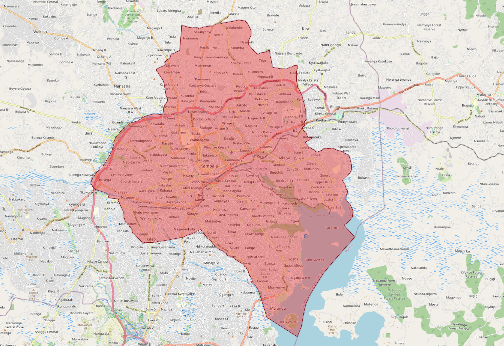

Scan preparation
================

Prepare the area of interest (AOI)
----------------------------------

To run the scan, a shapefile delineating the area of interest (AOI) is required. The NBSOS produces all outputs within the specified AOI. Depending on scope and purpose of the analysis, the AOI might resemble administrative units and could thus be aligned to administrative boundaries, such as city limits. It may also be drafted to follow built-up areas, or may match the extent of specific catchment areas or sub-catchments. The prepared AOI shapefile should be stored locally. 

The technical requirements for the AOI shapefile are as follows:

- Geometry type: *Polygon*
- Coordinate Reference System (CRS): *WGS84/EPSG:4326*

    An example of an AOI.

.. caution::

    If the AOI is very large, downloading relevant indicators or processing of data may take considerable time, or may fail for too large areas due to computational limitations imposed by Google Earth Engine. Therefore, it is recommeneded to balance the spatial extent of the area of interest, and to limit the number of vertices in the AOI polygon.

Obtain relevant data
--------------------

If pluvial flood benefits are to be assessed, relevant flood hazard data depicting flood extent for different return periods must additionally be obtained. The data should be stored locally; the path to this location is later referred to as the *pluvial_flood_hazard_data_path*.