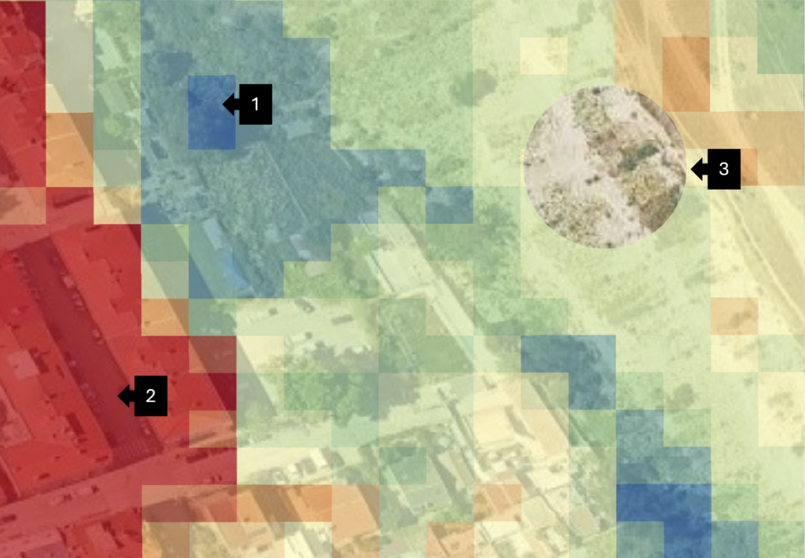
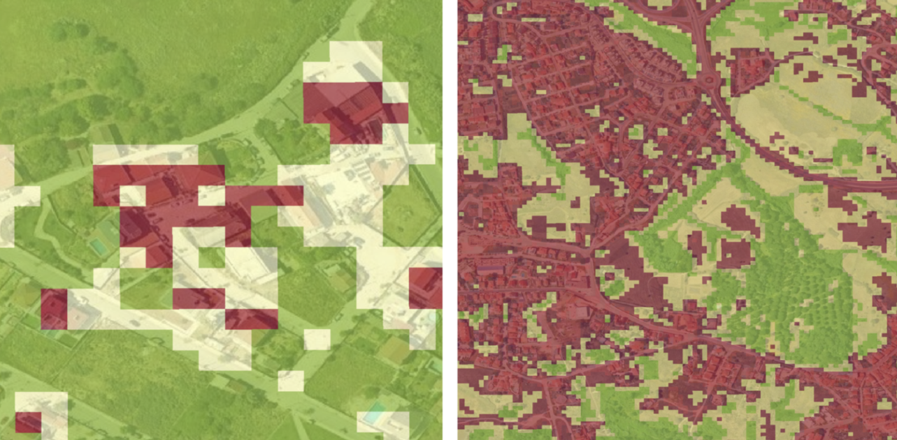

Identification of NBS protection and creation opportunities
===========================================================

The identification of NBS protection and creation opportunities relies on a clustering indicator and approach, as follows:

- A clustering indicator is created through the :py:meth:`nbsos.urban_v1.Scan.explore_clusters` method;
- The clustering indicator is then used to select a case-specific clustering threshold;
- The selected threshold is applied to identify NBS protection and creation opportunities, through the :py:meth:`nbsos.urban_v1.Scan.run_clustering` method.

Clustering indicator methodology
--------------------------------

For each indicator of bare soil frequency and land productivity performance, we
apply a Jenks natural breaks clustering algorithm to create rasters categorizing pixels
into five integer classes (1–5), where values equal to 1 represent the most degraded
land within the AOI (high bare soil frequency or low productivity performance) and
values equal to 5 represent the greenest regions within the AOI (low bare soil frequency
or high productivity performance). The respective clustered rasters are added together to
create a new raster with values ranging from 2 to 10, with lower values representing
more degraded land and higher values representing existing green space to protect.

Cluster solutions are explored running the :py:meth:`nbsos.urban_v1.Scan.explore_clusters` method.

.. code-block:: python

    # create the clustering indicator
    my_scan.explore_clusters()

.. admonition:: Technical note

    The clustering indicator named *clusters.tif* is located in the *cluster_maps* folder. Inspect the file using GIS software, to select an appropriate threshold.

Guidelines for selecting the cluster threshold value
----------------------------------------------------

A range of threshold values should be visually inspected to determine the appropriate
threshold for each AOI. It is recommended to begin by visually inspecting the condition
of vegetation at higher thresholds using satellite imagery. Examples of green spaces to
protect include green forest patches and grasslands. Progressively lower threshold
values should be inspected until a value associated with a higher frequency of bare
soil or degraded vegetation is found to be associated with the threshold value when
comparing to the satellite imagery. The threshold at which the cluster values no longer
correspond to existing, healthy green spaces should be chosen as the threshold value to
use in the NBSOS.

Load the corresponding data, clusters.tif from the cluster_maps folder, into a GIS software. Style the layer by unique values, and assign a color scale from red (for low cluster labels) to green/blue (for high cluster labels). Applying some transparency may ease cluster interpretation. Subsequently, as a background map, add Google Satellite or some other recent satellite imagery. Subsequently, the objective is to identify the cluster label, from two to ten,  which starts to differentiate between vegetation and greenery considered to be in a healthy state from greenery showing signs of degradation. Try to identify areas within the AOI that feature a cluster gradient over a comparatively short distance. This makes it easy to start comparing clusters. In QGIS, plugins such as QMapCompare may be installed to support this visual inspection.

   To support the visual inspection and cluster threshold selection, the semi-transparent cluster map is underlaid by Google Satellite Imagery. In this case, the QMapCompare plugin is additiopnally used to support visual inspection. Tree stands and grassy surfaces typically feature comparatively high cluster labels (1), these are considered healthy. Artificial surfaces, built-up areas etc. typically have the lower cluster labels (2). Surfaces that start to appear degraded guide threshold selection (3).

Areas that show somewhat degraded surfaces, or are starting to show higher shares of bare soil compared to other vegetated areas, typically correspond to the desired threshold label. It is suggested to select a likely clustering threshold, then confirm the appropriateness of the chosen threshold. The threshold is appropriate if it consistently matches areas with signs of potential degradation, but does neither match healthy vegetation nor artificial surfaces/built-up. To facilitate this review, you may apply a three-class color schema by styling all classes above the chosen threshold in a common color, e.g., green, the chosen class in a colour such as light red or yellow, and all classes lower than the chosen threshold in a third color, e.g., red; then inspect how this classification matches healthy vs. non-healthy vegetation in different parts of the AOI. Adjust the threshold and repeat the review, as needed.

   Selection, review and revision of the clustering threshold. Initially, a threshold is chosen that is likely inappropriate, as it captures larger shares of built-up areas and sealed surfaces. Similarly, class labels considered as healthy vegetation also capture sealed surfaces; the threshold is too low (left). After changing the threshold to a higher class label, classes shown in green seem to align well to grasslands and areas covered by trees. The class labels lower than the current threshold are predominantly matching artificial surfaces and built-up areas. The current threshold is not mapping grasslands and tree-covered areas, but matches areas showing signs of degradation (i.e., featuring higher shares of bare soil frequency); croplands may also fall into this category. This threshold is likely appropriate (right).

Run clustering method to identify creation and protection opportunities
-----------------------------------------------------------------------

To identify creation and protection opportunities, the :py:meth:`nbsos.urban_v1.Scan.run_clustering` method of the scan instance should be run, as exemplified below. The method requires the clustering threshold to be specified, as identified during the visual inspection and threshold selection process. The method will then generate the NBS family-specific creation masks and the NBS protection mask, based on the specified threshold and the suitability maps.

.. code-block:: python

    # run clustering
    my_scan.run_clustering(
        clustering_threshold=7
    )

.. admonition:: Technical note

    Within the data repository, the generated creation and protection masks are stored in the `suitability` folder. The creation masks follow the naming convention `<nbs_family>_creation.tif`, where `<nbs_family>` corresponds to the specific NBS family for which the creation mask was generated (see also :py:class:`nbsos.urban_v1.NbsTypes`). The NBS protection mask is named `nbs_protection_clustering.tif`.

Exclude areas from NBS creation opportunities
^^^^^^^^^^^^^^^^^^^^^^^^^^^^^^^^^^^^^^^^^^^^^

The NBSOS provides the ability to exclude specific areas from being considered as NBS creation opportunities through the use of masks. To do so, the :py:meth:`nbsos.urban_v1.Scan.run_clustering` method provides an optional *exclusion_masks* parameter. 

Areas to be disregarded for NBS creation opportunities could, for example, include  transportation infrastructure such as aerodromes, areas with military use, or protected areas. Such areas may be identified based on OpenStreetMap data. Some examples for key-value pairs, e.g., to retrieve these data with the QuickOSM plugin for QGIS, are summarized in :ref:`table-osm-masks`.

.. _table-osm-masks:

.. list-table:: QuickOSM key-value pairs for areas to potentially be excluded from NBS creation opportunities
   :header-rows: 1
   :widths: 45 25 30

   * - Description
     - Key
     - Value

   * - Aerodromes, airport perimeters
     - aeroway
     - aerodrome

   * - Ports, harbours
     - industrial
     - port

   * - Military uses
     - landuse
     - military

These masks should be prepared as shapefiles and stored in the *masks* folder of the scan's data repository, with the following specifications:

- Geometry type: *Polygon*
- Coordinate Reference System (CRS): *WGS84/EPSG:4326*

One or more shapefiles can be used to define areas to be excluded from NBS creation opportunities. 

A list of the filenames of these shapefile should be provided as argument to the *exclusion_masks* parameter of the :py:meth:`nbsos.urban_v1.Scan.run_clustering` method, as exemplified below (by default, the argument is set to None):

.. code-block:: python

    # run clustering with exclusion masks
    my_scan.run_clustering(
        clustering_threshold=7,
        exclusion_masks=["airports.shp"]
    )
