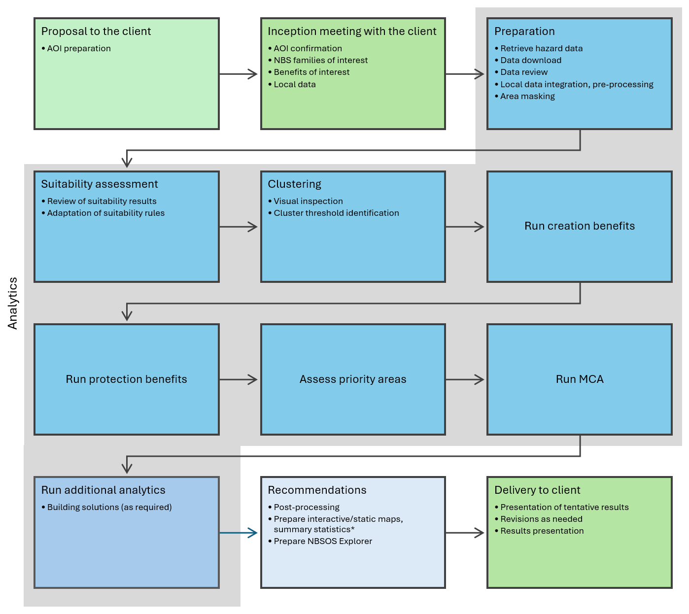

Workflow
========

The NBSOS workflow generally follows four stages: inception, analysis, synthesis and recommendations, and delivery. 
Each stage involves specific activities, as outlined below.

Inception stage
----------------

The inception stage involves the initial engagement with stakeholders to define the scope, objectives, and context of the NBSOS. Already in the proposal, a preliminary understanding of the local context and potential AOI should be developed. This initial understanding should subsequently be refined and validated in an inception meeting. 

The inception meeting brings together key stakeholders and team members to discuss NBS families and benefits of interest with respect to project scope and local context, and to confirm the AOI for the subsequent technical implementration of the NBSOS. The inception meeting may also discuss the availability and incorporation of local data. Local data may help to 

- replace global data with local data where appropriate. This may improve the accuracy and relevance of the assessment. Global data to potentially be replaced with local data may for example include population data;

- validate global data used in the NBSOS against local observations and local knowledge. For example, global flood hazard data could be compared to local data, to assess its accuracy and relevance;

- contextualize results of the NBSOS within the local setting. For example, results of the scan might be contextualized with respect to local infrastructures, land ownership, or  socio-economic conditions.

An inception note should be prepared to document the outcomes of the inception meeting, including the agreed-upon scope, objectives, AOI, relevant NBS families and benefits, and the availability and use of local data. This note serves as a reference for the subsequent stages of the NBSOS workflow.

Analysis stage
--------------

The analysis stage involves the technical implementation of the NBSOS. This stage includes a range of steps, as follows:

- Prepare the analytics. This step involves the retrieval and review of relevant datasets for the AOI, i.e., the global data used by the NBSOS as well as flood hazard data to be used in the analysis; the incorporation of local data, as needed; and the preparation of the data for subsequent analysis steps, including an identification of potential areas within the AOI that should be excluded from the analysis, such as aerodromes (as applicable);

- Assess suitability for NBS implementation. This step involves determining areas considered suitable for the implementation of NBS families within the AOI, and a review and/or the potential adaptation of the suitability criteria for each NBS family based on local conditions and constraints, as needed;

- Clustering. The clustering step involves determining a clustering indicator, the visual inspection of this cluster solution and the identification of a clustering threshold appropriate for the local context, and running a clustering method that determines NBS protection as well as NBS creation opportunities based on the chosen threshold;

- Running benefit models to identify creation benefits as well as protection benefits;

- The assessment of hazard exposure and the identification of priority areas;

- Conducting a spatial Multi-Criteria Analysis (MCA), to identify the optimal NBS family for each location within the AOI;

- Running additional analytics, as needed. 

Recommendations
---------------

The recommendations stage involves synthesizing the results of the analysis stage to provide insights and actionable guidance for stakeholders. 

Delivery
---------------

The delivery stage involves the dissemination of the recommendations and findings from the NBSOS workflow to relevant stakeholders. 